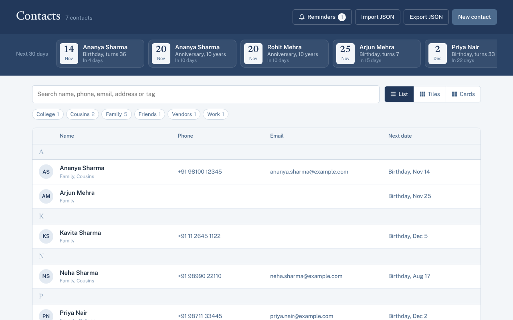
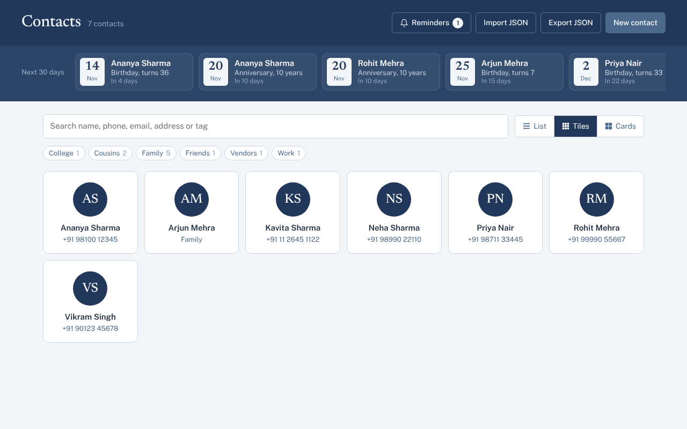
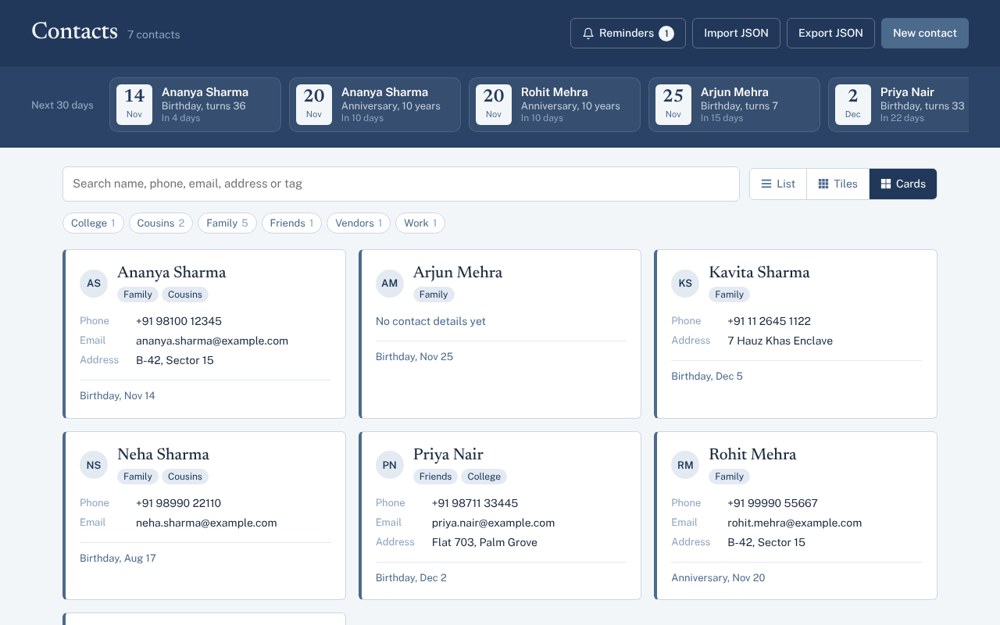
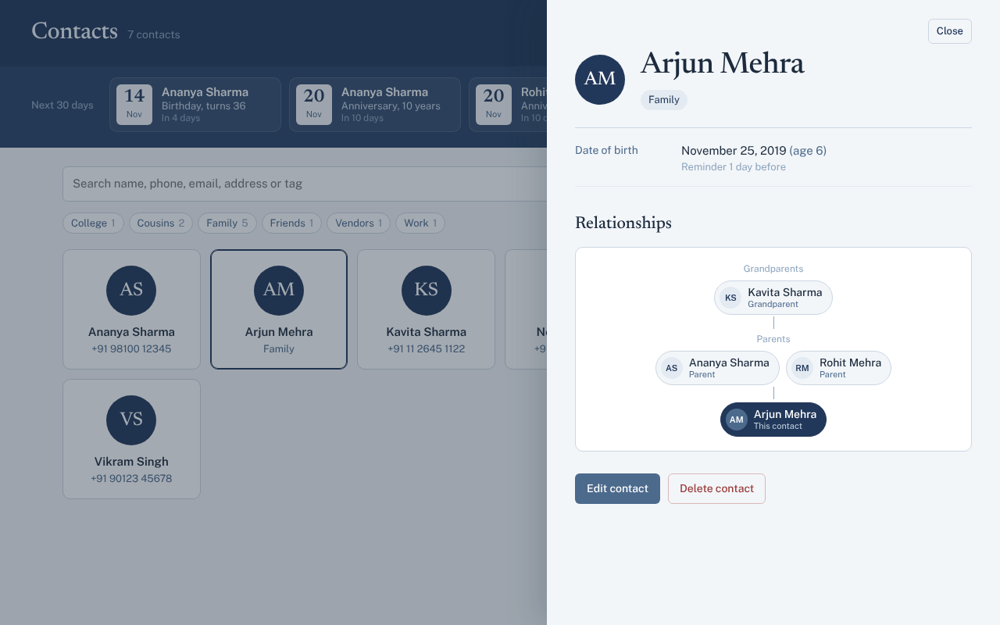
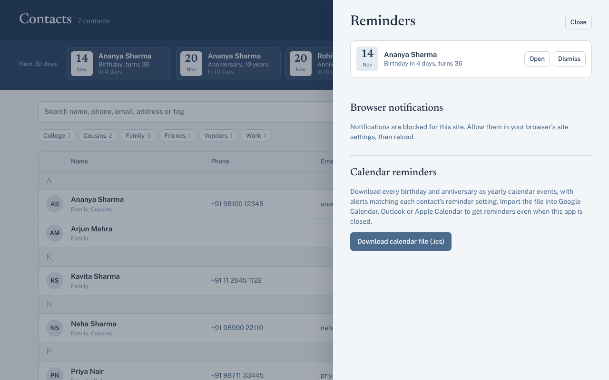

# Contact Book

A personal contact manager that runs entirely in the browser. It's built with plain HTML, CSS and JavaScript, with no frameworks, no build step and no backend. Your contacts are stored as JSON in the browser, and you can export or import them at any time.



## Features

- **Contact details:** name, multiple phone numbers, emails and addresses (each with a label like Mobile, Work or Home), date of birth and anniversary.
- **Tags:** add as many tags as you like to a contact, then filter the whole list by tag with one click.
- **Three layouts:** switch between List, Tiles and Cards. Your choice is remembered.
- **Search:** matches names, phone numbers, emails, addresses and tags as you type.
- **Upcoming dates:** a strip at the top shows every birthday and anniversary in the next 30 days, including the age someone is turning or how many years they've been married.
- **Reminders:** set a reminder for each birthday and anniversary, on the day or up to 14 days before. Due reminders show in the Reminders panel and can trigger browser notifications.
- **Calendar export:** download every birthday and anniversary as an `.ics` file with matching alerts, so reminders work in Google Calendar, Outlook or Apple Calendar even when the app is closed.
- **Relationships:** link contacts as parents, children, partners, siblings, relatives, friends or colleagues. Links are two-way automatically, and each contact shows a navigable family tree.
- **Import and export:** back up everything as a JSON file, or merge contacts in from one.
- **Responsive:** works on desktop and mobile, with keyboard support and visible focus states.

| Tiles | Cards |
| --- | --- |
|  |  |

| Relationship tree | Reminders |
| --- | --- |
|  |  |

## Getting started

Clone the repo and serve the folder with any static web server. A server is needed because the app loads its starter data with `fetch`, which browsers block on `file://` URLs.

```bash
git clone https://github.com/<your-username>/contact-book.git
cd contact-book
```

Then pick one:

```bash
# Node
npx serve .

# Python
python -m http.server 8000
```

Or open the folder in VS Code and use the Live Server extension.

Open the address the server prints (for example `http://localhost:8000`) and you're in.

If you open `index.html` directly from disk, the app still works but starts with an empty contact list.

## Project structure

```
contact-book/
├── index.html            Page layout
├── styles.css            All styling
├── app.js                App logic: storage, rendering, reminders, relationships
├── data/
│   └── contacts.json     Starter data loaded on first run
└── docs/
    └── screenshots/      Images used in this README
```

## How data is stored

On the first visit, the app loads `data/contacts.json` as starter data. From then on, every change is saved to the browser's `localStorage` under the key `contact-book.v2`. The JSON file on disk is never modified, since browsers can't write to files on their own.

This means:

- Your contacts stay on your device and in that one browser.
- Clearing site data, or using a different browser, starts you fresh.
- **Export JSON** is your backup. Use it regularly.

To reset the app back to the starter data, run this in the browser console and reload:

```js
localStorage.removeItem('contact-book.v2');
```

### Contact format

Each contact in the JSON file looks like this:

```json
{
  "id": "c_seed_1",
  "name": "Ananya Sharma",
  "phones": [
    { "label": "Mobile", "value": "+91 98100 12345" },
    { "label": "Work", "value": "+91 11 4567 8900" }
  ],
  "emails": [
    { "label": "Personal", "value": "ananya.sharma@example.com" }
  ],
  "addresses": [
    { "label": "Home", "value": "B-42, Sector 15\nNoida, Uttar Pradesh 201301" }
  ],
  "dob": "1990-11-14",
  "anniversary": "2016-11-20",
  "tags": ["Family", "Cousins"],
  "relations": [
    { "id": "c_seed_2", "type": "spouse" },
    { "id": "c_seed_5", "type": "parent" }
  ],
  "reminders": {
    "birthday": { "on": true, "days": 7 },
    "anniversary": { "on": true, "days": 1 }
  }
}
```

The fields work like this:

- **Dates** use `YYYY-MM-DD`. Leave them as an empty string or leave them out if unknown.
- **`relations`** reads as "this person is my ___". In the example above, contact `c_seed_5` is Ananya's parent. You only need to define a link on one side; the app fills in the reverse automatically when it loads.
- **Relationship types** are `parent`, `child`, `spouse`, `sibling`, `relative`, `friend` and `colleague`.
- **`reminders.days`** can be `0`, `1`, `3`, `7` or `14`. If `reminders` is missing, both reminders default to on, one day before.

Exported files are wrapped as `{ "version": 2, "exportedAt": "...", "contacts": [...] }`. Import accepts that format or a plain array of contacts. Contacts with a matching `id` are updated, and new ones are added.

Older v1 files, which used single `phone`, `email` and `address` strings, are converted automatically on load or import.

## Reminders

There are two ways to get reminded, and they work best together.

**Browser notifications.** Open the Reminders panel and select **Turn on notifications**. You'll get a notification for each due reminder, but only while the app is open in a browser tab. Each reminder notifies once per year, and dismissed reminders stay dismissed until next year's date.

**Calendar file.** In the Reminders panel, select **Download calendar file (.ics)** and import it into your calendar app. Each birthday and anniversary becomes a yearly all-day event, with an alert at 9 AM on the reminder day.

If you add or change dates later, download and import the file again. Events keep stable IDs, so most calendar apps update existing entries rather than duplicating them.

## Customizing

The main settings are constants at the top of `app.js`:

| Constant | What it controls |
| --- | --- |
| `UPCOMING_DAYS` | How far ahead the upcoming dates strip looks (default 30) |
| `LEAD_TIMES` | Reminder options in days |
| `LABELS` | Label choices for phones, emails and addresses |
| `REL_TYPES` | Relationship types, their display names and their reverse |

Colors and fonts are CSS variables at the top of `styles.css`.

## Browser support

The app works in current versions of Chrome, Edge, Firefox and Safari. It uses the native `<dialog>` element, the `Notification` API and `localStorage`.

Notifications need the page to be served over `http://localhost` or HTTPS.

## Limitations

- There's no sync between devices. To move contacts across, export JSON on one device and import it on the other.
- Browser notifications only fire while a tab with the app is open. Use the calendar export for reminders you can rely on.
- If data is edited in two tabs at once, the last save wins.
